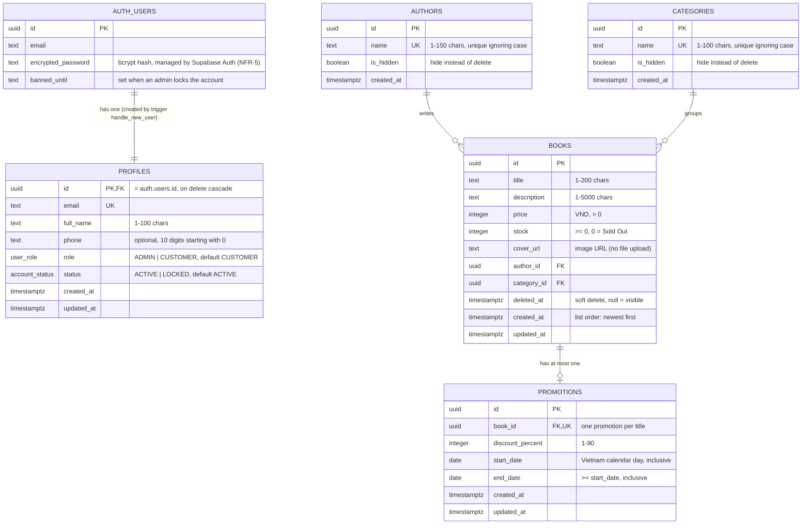

# ERD – E-Commercial Book Store, Release 1.0

Entity-relationship diagram of the Supabase (PostgreSQL) database (US-23 AC3). It is drawn from the migration files, which remain the single source of truth:

| Migration | Content |
|---|---|
| `supabase/migrations/20261027000001_schema.sql` | Types `user_role`, `account_status`; tables `profiles`, `categories`, `authors`, `books`; indexes; trigger `handle_new_user`; function `is_admin()` |
| `supabase/migrations/20261027000002_rls.sql` | Row Level Security policies on every table |
| `supabase/migrations/20261027000003_views.sql` | View `books_public` (what customers may see) |
| `supabase/migrations/20261105000001_promotions.sql` | Table `promotions` (CR-02, US-26) + RLS |
| `supabase/migrations/20261111000001_search_unaccent.sql` | Column `search_text` added to `books_public` (US-01) |

GitHub renders the diagram below. In VS Code, use a Mermaid preview extension.

## View `books_public`

Read by every customer page (F3, F4, F5): `books` joined with `authors` and `categories`. It keeps only books where `deleted_at is null`, the author is not hidden and the category is not hidden.

| Column | Source |
|---|---|
| `id`, `title`, `description`, `price`, `stock`, `cover_url`, `created_at`, `category_id`, `author_id` | `books` |
| `category_name` | `categories.name` |
| `author_name` | `authors.name` |
| `search_text` | `lower(unaccent(title)) ⏎ lower(unaccent(author name))`, for accent-insensitive search (US-01) |

## Rules enforced by the database

- **Soft delete only:** there is no `delete` policy on `books`, `categories` or `authors` (US-16, US-17, US-18).
- **Roles:** `is_admin()` checks `profiles.role = 'ADMIN'` and `status = 'ACTIVE'`. Every insert and update on the catalogue requires it (US-13, layer 3).
- **Indexes:** `books_list_idx (created_at desc, id desc) where deleted_at is null` for the paginated list (US-20, NFR-3); `books_cat_idx`, `books_price_idx` for the filters (US-09).
- **Passwords:** stored only in `auth.users` as bcrypt hashes. No `public` table has a password column (US-10 B3, NFR-5).
